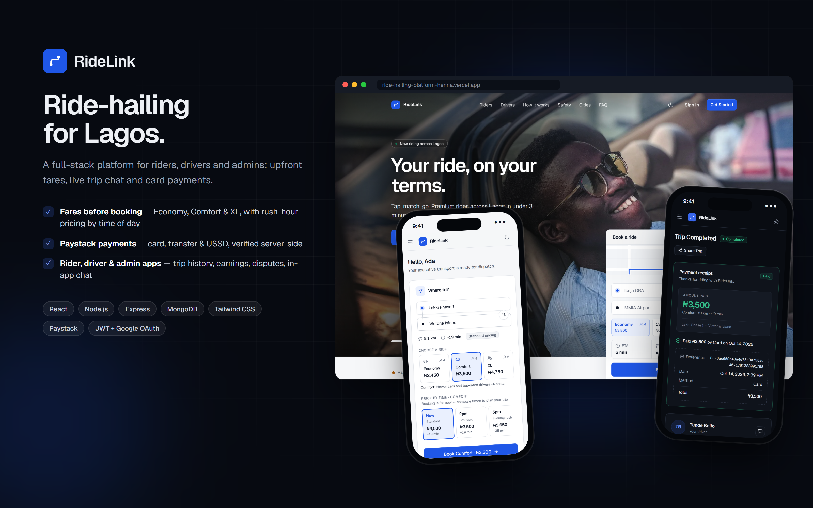
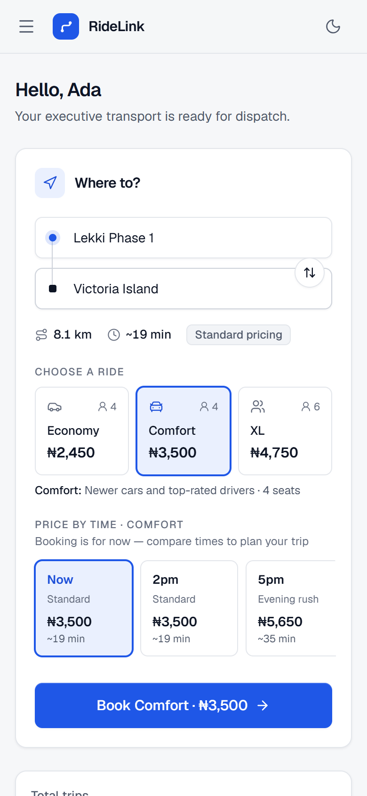
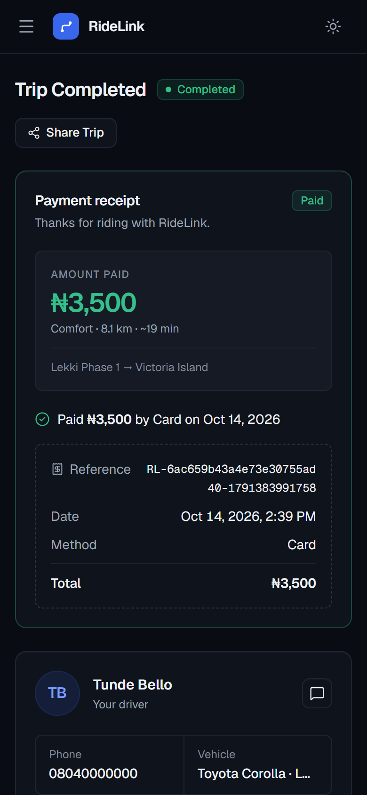
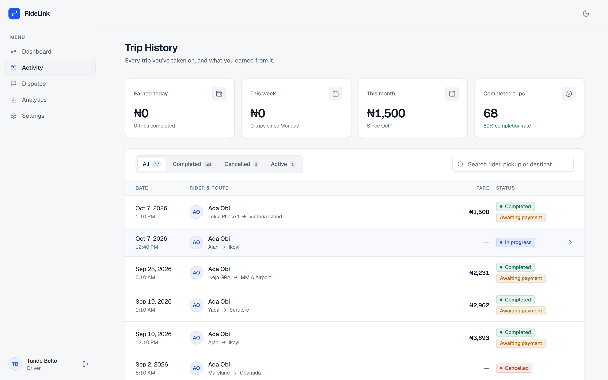

<p align="center">
  
</p>

<h1 align="center">RideLink</h1>

<p align="center">
  <b>A full-stack ride-hailing platform for Lagos, Nigeria</b><br>
  Upfront fares · in-app trip chat · Paystack payments · rider, driver &amp; admin apps
</p>

<p align="center">
  <a href="https://ride-hailing-platform-henna.vercel.app"><b>Live demo</b></a>
</p>

---

## About

RideLink connects riders with verified drivers across Lagos. Riders see the price of a trip **before** they book — for every ride type and at different times of day — then track the trip, chat with their driver and pay by card, bank transfer or USSD through Paystack. Drivers accept requests, run trips and follow their earnings. Admins approve drivers, resolve disputes and monitor the whole platform.

It's a school/portfolio project built end to end: React front end, Node/Express API, MongoDB database, deployed on Vercel and Render.

## Features

**Riders**
- Lagos place search (56 areas and landmarks) with instant fare estimates for **Economy, Comfort and XL**
- **Price by time of day** — compare the same trip at rush hour, midday or late night before booking
- Fares are calculated on the server and locked at booking; if the price changes, the rider is asked to confirm
- Live trip status, **in-app chat** with the driver, call the driver, share trip details
- **Pay with Paystack** (card, transfer, USSD) after the trip, with a receipt
- Trip history, spending analytics, disputes, profile and password settings

**Drivers**
- Live trip requests with fare, ride type and distance; accept and run trips step by step
- Trip history with **real earnings** (today, this week, this month) and monthly charts
- See whether the rider has paid; emergency call (112), directions link, in-app chat

**Admins**
- Approve or reject new drivers; review, escalate and resolve disputes; export disputes to CSV
- Platform analytics: trips, revenue, completion rate and 12-month trends; all trips with payment status

**Accounts & platform**
- Email/password and **Google sign-in**, JWT sessions, role-based access (rider, driver, ops manager, super admin)
- **Password reset by email** (EmailJS)
- Responsive on phone, tablet and desktop, with **light and dark mode**
- Marketing landing page with photo carousel, animated live-ride map and fare demo (Lighthouse mobile: Performance 90+, Accessibility 100)

## Screenshots

| Fare estimate before booking | Payment receipt | Driver trip history |
|---|---|---|
|  |  |  |

## Tech stack

| Layer | Technology |
|---|---|
| Front end | React 19, Vite, React Router, Tailwind CSS, lucide-react |
| Back end | Node.js, Express, Mongoose |
| Database | MongoDB Atlas |
| Auth | JWT, bcrypt, Google OAuth |
| Payments | Paystack (initialize, verify, signed webhooks) |
| Email | EmailJS (password reset) |
| Hosting | Vercel (client), Render (API) |

## How pricing works

Fares come from `server/src/utils/pricing.js`: road distance between the two places (straight-line distance × 1.35), estimated travel time by time of day, and per-ride-type rates (base + per km + per minute, with a minimum fare). Weekday rush hours (7–10am ×1.35, 4–8pm ×1.4) and late nights (×1.2) cost more and move slower. The same function produces the estimate the rider sees and the fare stored on the trip, so the two always match.

## Run it locally

**Requirements:** Node.js 20+, a MongoDB database (local or Atlas).

```bash
git clone https://github.com/D-creativeOlah123/ride-hailing-platform.git
cd ride-hailing-platform

# API
cd server
npm install
# create server/.env (see below), then:
npm run dev                  # http://localhost:5000
node src/seedAdmins.js       # optional: create the two admin accounts

# Web app (new terminal)
cd client
npm install
npm run dev                  # http://localhost:5173
```

**`server/.env`**

| Variable | Purpose |
|---|---|
| `MONGO_URI` | MongoDB connection string |
| `JWT_SECRET` | Secret for signing login tokens |
| `CLIENT_URL` | Web app URL (used in reset-password and payment links) |
| `PAYSTACK_SECRET_KEY` | Paystack secret key (`sk_test_…` for test mode) |
| `GOOGLE_CLIENT_ID` | Google OAuth client ID |
| `EMAILJS_SERVICE_ID`, `EMAILJS_TEMPLATE_ID`, `EMAILJS_PUBLIC_KEY`, `EMAILJS_PRIVATE_KEY` | Password-reset emails |
| `SUPER_ADMIN_EMAIL` / `_PASSWORD` / `_PHONE`, `OPS_ADMIN_EMAIL` / `_PASSWORD` / `_PHONE` | Admin accounts for the seed script |
| `DNS_SERVERS` | Optional, e.g. `8.8.8.8,1.1.1.1` if your network blocks MongoDB SRV lookups |

**`client/.env.local`** — `VITE_API_URL` (e.g. `http://localhost:5000/api`) and `VITE_GOOGLE_CLIENT_ID`.

Everything works without the optional keys: without Paystack the Pay button says payments aren't switched on, and without Google the Google button explains it isn't set up.

**Test payments:** in Paystack test mode, use card `4084 0840 8408 4081`, any future expiry, CVV `408` (PIN `0000`, OTP `123456`).

## Project structure

```
client/                 React app (Vite)
  src/pages/            rider/, driver/, admin/, auth/ and the landing page
  src/components/       app shell, booking (place search + estimates), payments, chat, landing sections
  src/utils/            trip statistics helpers
server/
  src/routes/           auth, trips (+ estimates & chat), payments, disputes, admin
  src/models/           User, Trip, Message, Dispute
  src/utils/pricing.js  fare engine
  src/data/             Lagos places
```

## Credits

Landing-page photos from [Unsplash](https://unsplash.com) (Unsplash licence); photographers are listed in `client/scripts/landing-images.json`. The companies named on the landing page are fictional.
